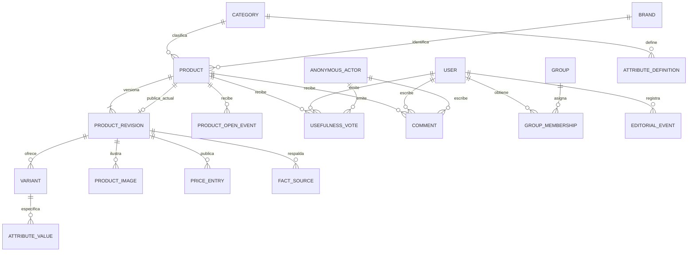

# CAT — Arquitectura y plan técnico

Versión: 0.3. Estado: **baseline aprobada el 2026-10-26**.  
Spec de referencia: [`spec.md`](spec.md), versión 0.20, aprobada.  
Decisiones: DEC-001 a DEC-024 confirmadas; ADE-001 a ADE-019 adoptadas en [`docs/decisions.md`](../../docs/decisions.md).  
Implementación: **no autorizada**. Ver [`docs/baseline.md`](../../docs/baseline.md).

> El plan está aprobado como diseño técnico y no habilita por sí solo escribir el producto.
> Los ejemplos de registros y datos de prueba deberán ser ficticios.

## 1. Objetivo y alcance del plan

Definir una arquitectura web mantenible por un equipo pequeño para el catálogo
público, la edición manual de productos, las cuentas opcionales, los votos y la
moderación previa de comentarios. La fuente de comportamiento es la spec; toda
decisión de interfaz o dominio que cambie ese comportamiento debe resolverse allí
antes de implementar.

### Hechos confirmados

- Catálogo inicial de ocho categorías, con al menos una ficha publicada y
  revisada por categoría antes del lanzamiento; no hay cuota adicional de
  productos/variantes ni promesa de cobertura exhaustiva (DEC-007, DEC-022,
  DEC-023).
- Interfaz pública en español; audiencia internacional y precio aproximado en USD
  cargado manualmente (DEC-006, DEC-013, DEC-014).
- Mantenimiento inicialmente manual; automatización por API no es dependencia
  del MVP (DEC-005).
- Popularidad: apertura de una ficha desde resultados internos, toda apertura
  suma, ventana móvil de 30 días (DEC-016 a DEC-019).
- Registro opcional, voto de utilidad editable por participante y comentarios
  sujetos a aprobación de un moderador designado (DEC-009, DEC-010, DEC-020,
  DEC-021).
- Comparación lado a lado fuera de alcance (DEC-012).

### Arquitectura confirmada y defaults de diseño (DEC-024, ADE-016)

- **Confirmado por DEC-024:** aplicación Django modular con HTML renderizado en
  servidor; el MVP no separa frontend y backend.
- **Default delegado ADE-016:** PostgreSQL como base relacional; validar versión y
  compatibilidad antes de implementar.
- Separar catálogo/editorial, participación pública, identidad y configuración
  para que los permisos y las reglas de dominio sean localizables; la estructura
  física se detalla en `development-conventions.md` según ADE-017.
- Usar el panel administrativo del framework para operaciones internas sencillas,
  más vistas de equipo específicas para flujos editoriales o de moderación que
  requieran estados y auditoría.
- Tratar los contratos de categorías y variantes como datos de dominio explícitos,
  no como un diccionario libre sin validación.

## 2. Stack técnico aprobado para planificación

| Parte | Base elegida para planificación | Criterio | Requisito relacionado |
|---|---|---|---|
| Lenguaje y servidor | Django integrado confirmado por DEC-024; Python 3.13.x y Django 6.1.x son versiones base de ADE-016, a revalidar antes de implementar | Un stack integrado reduce piezas de operación y es adecuado para catálogo, formularios, sesiones y administración | CAT-RF-001 a 019 |
| Base de datos | PostgreSQL 18.x, por ADE-016; revalidar parche menor antes de implementar | Restricciones relacionales para identidad, unicidad, moderación y datos normalizados | CAT-RF-001, 003, 005 a 017 |
| Interfaz | Plantillas HTML de servidor, CSS adaptable y JavaScript mínimo sin framework, por ADE-016 | Evita mantener dos aplicaciones y permite controles accesibles con complejidad moderada | CAT-RF-002 a 009, 016 a 018; CAT-RNF-001/002 |
| Administración | Django Admin para CRUD interno acotado; vistas de equipo propias cuando haya workflow editorial/moderación | Admin como herramienta interna; no como interfaz pública ni reemplazo automático de cada flujo | CAT-RF-010, 011, 015 |
| Imágenes | Archivos servidos desde almacenamiento de objetos compatible con el hosting elegido; el proveedor queda pendiente | Aísla la base de datos de binarios y permite imágenes de catálogo | CAT-RF-004, decisión de hosting pendiente |
| Búsqueda inicial | Búsqueda de marca, modelo y nombre mediante capacidades relacionales, según ADE-003 | El contrato no requiere motor especializado | CAT-RF-002; CAT-CA-019 |
| Despliegue | Proveedor no elegido; usar un entorno gestionado compatible con el stack hasta conocer presupuesto y región de servicio | Mantiene portabilidad sin inventar costos | CAT-RNF-002 a 004; PND-012 |
| Dependencias Python | `uv`, `pyproject.toml` y `uv.lock` versionado; versiones bloqueadas y actualizadas mediante cambio revisado | Instalaciones reproducibles con una sola herramienta de proyecto | ADE-017; `docs/development-conventions.md` |
| Pruebas | Runner integrado de Django con `django.test.TestCase`; `manage.py test` | Evita añadir un runner distinto al framework sin necesidad demostrada | CAT-CA-001 a 041; ADE-017 |
| Formato y lint | Ruff para formato y análisis estático | Una herramienta cubre ambos usos y se configura en `pyproject.toml` | ADE-017; CI |
| Base local/CI | PostgreSQL 18 mediante Docker Compose en desarrollo y servicio efímero en CI | Verifica migraciones, índices y restricciones en el motor objetivo | ADE-016; PND-012 para alojamiento de producción |

Las versiones son defaults delegados para planificar, no una autorización para
instalar dependencias ahora. Deben verificarse de nuevo durante el descubrimiento
técnico previo a la implementación. Las versiones de Django documentan compatibilidad con
Python 3.12–3.15 y PostgreSQL 15 o posterior; la rama PostgreSQL 18 cuenta con
soporte publicado hasta noviembre de 2030. Referencias oficiales consultadas el
26-10-2026: [Django 6.1 release notes](https://docs.djangoproject.com/en/dev/releases/6.1/),
[Django database support](https://docs.djangoproject.com/en/6.1/ref/databases/),
[Django Admin](https://docs.djangoproject.com/en/dev/ref/contrib/admin/),
[PostgreSQL versioning](https://www.postgresql.org/support/versioning/).

**Alternativa no seleccionada para el MVP (DEC-024):** Node.js 24, TypeScript 6,
NestJS 11, Prisma 7, React 19/Vite y PostgreSQL 18. Este stack también puede
implementar el catálogo; no se adopta para el MVP por la
separación frontend/API, el contrato de red y las herramientas adicionales que
implica. Se reconsiderará si el equipo ya domina TypeScript, necesita clientes
distintos o aparecen requisitos de interacción que justifiquen esa separación.

**Otras alternativas consideradas:** una SPA separada (React/Next) más API y una
base NoSQL flexible. Se proponen como alternativas descartadas provisionalmente
porque añaden despliegues y duplicación de modelos sin una necesidad confirmada.
Reabrirlas si aparecen requisitos de integración, interacción rica o escala que
justifiquen esa complejidad.

Las decisiones sobre estructura física, gestor de dependencias, Git/CI y reglas
de contribución se reúnen en [`docs/development-conventions.md`](../../docs/development-conventions.md)
y forman parte de la baseline aprobada.

## 3. Límites de módulos y responsabilidades

| Módulo lógico | Responsabilidad | No debe asumir | Requisitos |
|---|---|---|---|
| `catalog` | Categorías, marcas, productos, variantes, atributos, imágenes, precios y estados de publicación | Identidad de visitantes o política de aprobación de comentarios | CAT-RF-004 a 011 |
| `discovery` | Portada, consulta, búsqueda, filtros, orden, paginación y conteos; registra apertura originada en búsqueda | Convertir impresiones en aperturas o usar votos como popularidad | CAT-RF-001 a 003, 016, 017 |
| `community` | Voto actual por actor/producto, comentarios y estados de moderación | Hacer públicos comentarios pendientes o mezclar voto de ficha con rating del hardware | CAT-RF-012, 013, 015 |
| `accounts` | Registro/sesión de visitantes, token anónimo de primera parte y permisos de equipo | Prometer que un navegador anónimo equivale a una persona real | CAT-RF-014; CAT-CA-031, 034, 035 |
| `editorial` | Revisión, publicación, retiro, fuentes internas y auditoría de cambios | Aprobar datos por el solo hecho de existir o inventar contenido | CAT-RF-010, 011; CAT-CA-025, 026, 029 |
| `web` | Rutas, plantillas, formularios, accesibilidad, tema e idioma visible | Contener cálculo de popularidad o reglas de persistencia | CAT-RF-002 a 009, 016 a 018; CAT-RNF-001 a 004 |
| `config` | Ajustes, seguridad de sesión, conexión y tareas operativas | Guardar secretos en el repositorio | Todos; decisiones operativas pendientes |

Correspondencia física: las primeras cinco áreas son `apps/catalog`,
`apps/discovery`, `apps/community`, `apps/accounts` y `apps/editorial`; `config`
es el proyecto Django. El módulo lógico `web` se reparte entre `config/urls.py`,
rutas/vistas por app y los directorios compartidos `templates/` y `static/`, según
ADE-017. No se añade una app `web` sin responsabilidades propias.

La división puede ajustarse en implementación si conserva responsabilidades,
contratos y trazabilidad; cambiar comportamiento requiere actualizar primero la
spec. Evitar crear servicios distribuidos para el MVP.

## 4. Actores, permisos y flujos

| Actor | Capacidad | Límites |
|---|---|---|
| Visitante anónimo | Consultar, buscar, filtrar, votar y enviar comentario | Identidad por cookie limitada a navegador; no equivale a persona verificada (ADE-011) |
| Visitante registrado | Capacidades públicas y cuenta opcional, correo verificado y alias visible | El correo es privado; aportes anónimos no se fusionan automáticamente (ADE-014) |
| Editor | Crear y corregir borradores; enviar revisión | No publica; requiere Revisor de catálogo (ADE-005) |
| Revisor de catálogo | Validar checklist, publicar/retirar fichas y gestionar destacados | Solo permiso explícito; registra actor y fecha (ADE-005/009) |
| Moderador designado | Aprobar, rechazar o retirar aprobación de comentarios | Permiso separado de edición/publicación de producto (DEC-021, ADE-005/013) |
| Operador técnico | Configurar despliegue, respaldos y monitoreo | No se presume que pueda aprobar contenido o moderar por su función técnica |

Flujo editorial: borrador → revisión pendiente → publicado → retirado. Una
corrección crea una nueva revisión y la versión pública permanece hasta que el
Revisor de catálogo publique la nueva. Los eventos conservan actor y fecha.
Comentario: pendiente → aprobado/rechazado → aprobación retirada; solo aprobados
son públicos. Estos defaults esperan la aprobación de la baseline completa.

## 5. Contratos de interfaz y flujos de datos

Rutas candidatas de implementación; los slugs y la forma final de URL se pueden ajustar si no cambian el contrato de consulta:

| Ruta lógica | Uso | Entrada / salida principal | Requisitos |
|---|---|---|---|
| `/` | Portada con destacados/populares | Preferencias de orden no requeridas; tarjetas de productos publicados | CAT-RF-001 |
| `/buscar/` | Buscar y filtrar catálogo | `q`, categoría, marcas, rangos, filtros técnicos, orden y página; listado y conteo | CAT-RF-002, 003, 016, 017 |
| `/categorias/<slug>/` | Navegación de categoría | Slug de categoría y filtros válidos para ella | CAT-RF-003, 006 |
| `/productos/<slug>/` | Ficha y participación pública | Ficha de una variante/producto, precio, fecha, pros/contras, votos y comentarios aprobados | CAT-RF-004 a 009, 012, 013 |
| `/cuenta/registro/`, `/cuenta/ingreso/`, `/cuenta/salida/` | Cuenta opcional | Formularios y estados de autenticación | CAT-RF-014; ADE-014 |
| `/equipo/` | Flujos internos editoriales/moderación | Sesión de equipo y permiso específico | CAT-RF-010, 011, 015 |
| `/admin/` | Administración interna restringida | Modelos simples autorizados | CAT-RF-010, 011 |

Flujo de consulta: normalizar la consulta → validar filtros contra el diccionario
de la categoría → combinar los grupos según CAT-CA-020 a 022 → calcular el total
de coincidencias → ordenar incluyendo desempates y ausentes → paginar → renderizar.
La consulta se conserva en parámetros GET para permitir recargar y compartir la vista.

Flujo de popularidad: registrar únicamente apertura desde resultados internos →
contar aperturas de la ventana móvil de 30 días, excluir rastreadores conocidos →
agrupar y ordenar por cantidad, nombre normalizado y slug. Si el total de la
ventana es cero, mostrar destacados manuales. Impresiones y navegación directa no
cuentan; no se usa huella digital.

Flujo de participación: validar cuenta o token anónimo → comprobar que la ficha
esté publicada → crear/reemplazar voto o recibir comentario → aplicar rate limit
por identidad → guardar la operación de forma atómica → exponer conteos de votos
y solo comentarios aprobados.

## 6. Modelo de datos aprobado para planificación

El diagrama fija el modelo conceptual aprobado. No es un esquema de migración;
los tipos físicos e índices se concretarán al implementar, preservando las
identidades, relaciones y reglas definidas aquí y en la spec.

| Entidad | Campos y concepto aprobados | Detalle técnico que se fija al implementar |
|---|---|---|
| `Category` | id, slug estable, nombre español, estado | Lista inicial cerrada; crecimiento futuro con decisión |
| `Brand` | id, nombre oficial, slug/alias de búsqueda | Normalización, marcas homónimas y alias |
| `Product` | identidad estable: categoría, marca, modelo, slug, estado de retiro y referencia a revisión pública vigente | Votos, comentarios y aperturas apuntan aquí para sobrevivir a revisiones; identidad según ADE-006 |
| `ProductRevision` | número, contenido completo de una versión, descripción, lanzamiento, pros/contras, estado, editor, revisor y fechas | Corrección copia la versión vigente; publicar cambia la referencia pública atómicamente y archiva la anterior; guardado obsoleto no sobrescribe otra edición; ADE-005/009 |
| `Variant` | revisión padre, id comercial/SKU, color/configuración, atributos propios y precio/imágenes cuando varíen | Una selección nunca hereda valores incompatibles; pertenece a una revisión inmutable tras publicar (ADE-006) |
| `AttributeDefinition` | categoría, clave, etiqueta, tipo, unidad, opciones, obligación, filtro/publicación | Diccionario inicial en `category-data.md` (ADE-007) |
| `AttributeValue` | variante, atributo, valor tipado, estado del dato y referencia interna | Normalizar unidades; distinguir estados de ausencia |
| `FactSource` | revisión, hecho/atributo respaldado, título/URL o identificador, tipo de fuente y fecha de verificación | Atributos técnicos obligatorios tienen al menos una fuente interna; conservar evidencia suficiente para revisión (ADE-008/018) |
| `ProductImage` | revisión/variante, archivo, texto alternativo, orden, fuente y estado de permiso | Solo medios con permiso de uso verificado; cambiar imagen crea una revisión (ADE-008) |
| `PriceEntry` | revisión/variante, importe decimal USD, estado visible | A lo sumo un precio visible por revisión/variante; positivo y máximo dos decimales; opcional; método/fuente los carga el equipo (DEC-013, ADE-004) |
| `FeaturedSelection` | producto, posición, vigencia, Editor que propuso, Revisor que publicó | Se muestra si no hay aperturas válidas (ADE-002/005) |
| `ProductOpenEvent` | producto, instante UTC de apertura válida | Un evento por apertura desde búsqueda; no guarda actor/IP/user-agent; consulta exacta de 30 días y borrado de eventos expirados (ADE-019) |
| `User` | modelo Django propio desde migración inicial: email único de inicio de sesión, hash de contraseña gestionado por Django, alias público, verificación, estado y flags internos | No almacenar contraseña en texto plano; mantener correo privado; ADE-014 |
| `GroupMembership` | usuario y grupo Django: Editor, Catalog Reviewer, Moderator | Grupos asignan permisos por separado; se pueden combinar según ADE-005 |
| `AnonymousActor` | hash del token aleatorio, fecha de creación y expiración | Nunca guardar el token original, IP o huella digital; purgar tokens expirados (ADE-011) |
| `UsefulnessVote` | producto, valor sí/no, usuario o actor anónimo, fecha | Exactamente un actor; unicidad por actor/producto; cambio atómico (ADE-011/012) |
| `Comment` | producto, autor registrado/anónimo, texto, estado, fechas y moderador | Exactamente un actor; 1–2.000 caracteres; auditoría; solo aprobados públicos (ADE-013) |
| `EditorialEvent` | actor, entidad/revisión, acción y fecha | Registrar publicación, corrección, retiro, revisión periódica y moderación sin conservar contenido personal innecesario |

El usuario registrado extiende `AbstractUser` de Django con `email` como campo
de inicio de sesión y `username` desactivado; se configura como `AUTH_USER_MODEL`
antes de la primera migración. Los grupos Django representan los roles internos
y la autorización se comprueba en servidor. Cada voto/comentario debe tener
exactamente un autor: cuenta registrada o actor anónimo.

Los grupos internos se mapean a `catalog_editor`, `catalog_reviewer` y
`moderator`; una cuenta puede pertenecer a más de uno. Las cuentas públicas no
reciben esos grupos. El acceso al panel Django requiere `is_staff` además del
permiso concreto.

Una corrección crea `ProductRevision` copiando el contenido publicado actual.
Mientras se edita o revisa, `Product.current_public_revision` sigue apuntando a
la versión pública anterior. Al aprobar, una transacción publica la nueva revisión
y cambia el puntero; la versión anterior se conserva como histórica. Variantes,
atributos, imágenes y precios pertenecen a esa revisión; votos y comentarios
permanecen asociados al `Product` estable.

Los borradores se guardan con una versión de edición. Si la versión cambió desde
que un Editor abrió el formulario, se rechaza su envío obsoleto para evitar perder
cambios. Retirar una ficha elimina la referencia pública, la oculta de listados y
bloquea nuevos votos/comentarios; las revisiones se conservan internamente.

El conteo registra eventos con instante UTC y consulta el intervalo exacto
`(ahora - 30 días, ahora]`. Una tarea periódica purga eventos expirados; la consulta
aplica siempre el límite temporal aunque la purga se ejecute después.

Restricciones técnicas que preservan el contrato: slug único; precio positivo
con máximo dos decimales; claves foráneas; unicidad de voto por actor y producto;
transición de comentario validada en servidor; índices para categoría/marca,
precio/fecha y fecha/cantidad de popularidad. Las reglas de valores aceptables
permanecen definidas en la spec y también se aplican en servidor/base de datos.

Los atributos técnicos se almacenan con estructura tipada por categoría; no se
usa un campo JSON libre como sustituto del diccionario aprobado.

## 7. Acceso, privacidad y seguridad

- Separar permisos públicos de equipo; comprobar permiso en el servidor para cada
  operación de escritura, no ocultar controles como única protección.
- El contenido de comentarios se almacena como texto y se codifica al presentarse;
  no se interpreta HTML introducido por el público.
- Proteger formularios y sesiones con mecanismos del framework; secretos fuera
  del repositorio; aplicar límites de CAT-CA-030/033 en el servidor.
- Guardar la mínima identidad necesaria para voto/comentario. El token anónimo
  dura 12 meses y no se vincula a IP ni a cuenta; se informa su límite (ADE-011).
- No incluir correo, IP u otro dato personal en estadísticas públicas. El correo
  registrado es privado; los comentarios aprobados se anonimizan al borrar cuenta.
  La política final de privacidad y retención debe revisarse para mercados de
  lanzamiento (PND-020).
- Registrar quién publica una ficha y quién aprueba/rechaza comentario; evitar
  que el log conserve innecesariamente texto sensible.
- Antes de operar, revisar amenazas de abuso, spam, enumeración, carga de imágenes
  y vistas internas; PND-020 requiere revisar cookies, privacidad y permisos de uso.

## 8. Estrategia de verificación aprobada

Estos son niveles y casos planeados; ninguno está implementado ni ejecutado.
Los CAT-CP existentes están diseñados en [`acceptance.md`](acceptance.md).

| Nivel | Qué verificar | Evidencia al implementar |
|---|---|---|
| Dominio | Ventana de popularidad de 30 días, filtros y orden, normalización de búsqueda, transiciones editoriales y de comentarios, votos editables, valores ausentes y atributos por categoría | `django.test.TestCase` y pruebas aisladas por regla/caso límite |
| Integración de datos | Restricciones de unicidad, transacciones concurrentes de voto, visibilidad por estado, filtros SQL, migraciones y fixtures ficticios | `TestCase` contra PostgreSQL 18; sin depender de datos reales |
| Interfaz/rutas | Estados de carga, vacío, error, filtro inválido, ficha retirada, envío pendiente, permisos; navegación de teclado y tema | Django test client para respuestas HTTP; revisión manual de teclado y viewport |
| Flujo completo | Búsqueda → ficha → voto/comentario → aprobación → publicación; Editor publica; Moderador aprueba; usuario sin permiso recibe rechazo | Pruebas de integración Django ligadas a CAT-CP; sin framework E2E adicional en MVP |
| Calidad no funcional | WCAG 2.2 AA, rendimiento de campo, seguridad de sesiones, derechos de medios y respaldo/restauración | CAT-CA-037 a CAT-CA-039; hosting, revisión legal y operación pendientes por PND-012/020 |
| Lanzamiento | Cobertura mínima, revisión de contenido, privacidad, permisos, respaldo y ruta de reversión | Checklist con resultado, responsable, fecha y evidencia por gate |

La tabla requisito/parte del plan de abajo no sustituye los criterios de
aceptación. Cada RF de la baseline tiene uno o más CAT-CA y CAT-CP diseñados,
como se refleja en `acceptance.md` y `traceability.md`.

## 9. Calidad, accesibilidad y operación

Los objetivos de calidad siguientes forman parte de la baseline aprobada mediante
ADE-010 y CAT-CA-037/038. Los objetivos operativos que dependen del proveedor,
presupuesto o tráfico real permanecen como gates PND-012.

- Accesibilidad: WCAG 2.2 nivel AA para las vistas públicas y de
  equipo; comprobar teclado, foco, etiquetas, contraste, errores, encabezados,
  zoom/reflow y texto alternativo. El estándar es una recomendación W3C publicada:
  [WCAG 2.2](https://www.w3.org/TR/WCAG22/).
- Rendimiento: evaluar Core Web Vitals de campo en percentil 75 por
  móvil/escritorio —LCP ≤ 2,5 s, INP ≤ 200 ms y CLS ≤ 0,1— cuando haya tráfico
  representativo. Son metas de referencia, no un SLA de hosting. [Web Vitals](https://web.dev/articles/vitals).
- No se fija SLA de disponibilidad, retención, tráfico esperado, tiempo de
  restauración ni presupuesto sin conocer hosting y expectativas operativas.
- Frecuencia de respaldo, objetivos RPO/RTO, métricas operativas, telemetría y
  mecanismo de reversión se concretarán al cerrar PND-012.
## 10. Decisiones técnicas y alternativas

| ID | Decisión técnica | Alternativa considerada | Motivo | Estado / requisitos |
|---|---|---|---|---|
| TDEC-001 | Django monolítico modular | SPA + API independiente | Menos despliegues para flujos CRUD y formularios | Confirmada por DEC-024; CAT-RF-001 a 019 |
| TDEC-002 | PostgreSQL relacional | NoSQL documental | Relaciones, unicidad y filtros estructurados son centrales | Seleccionada por delegación ADE-016; CAT-RF-003, 005, 012, 015 |
| TDEC-003 | HTML de servidor + JavaScript mínimo | Framework frontend separado | Reduce complejidad y duplica menos contratos | Confirmada por DEC-024; CAT-RF-001 a 009, 016 a 018 |
| TDEC-004 | Archivos de imagen en object storage | Binario dentro de PostgreSQL o ruta local | Separa media y datos; proveedor se difiere | Default técnico; proveedor sujeto a PND-012; CAT-RF-004 |
| TDEC-005 | Eventos individuales de apertura sin identidad, IP ni user-agent; consulta exacta de ventana móvil de 30 días y purga de eventos expirados | Agregados diarios, que no representan con precisión una ventana móvil exacta | Conserva el límite temporal exacto sin identificar visitantes | Seleccionada; ADE-019; CAT-RF-001, CAT-CA-018 |
| TDEC-006 | Admin del framework para CRUD interno simple y vistas dedicadas para workflow | Construir todo desde cero o exponer Admin como producto público | Aprovecha CRUD probado sin acoplar proceso editorial complejo | Seleccionada como base; CAT-RF-010, 015 |
| TDEC-007 | Hechos técnicos tipados y contenido editorial en español | Fichas de texto libre sin esquema | Permite filtros fiables y revisión por categoría | Seleccionada; ADE-007/008; CAT-RF-006, CAT-RNF-001 |
| TDEC-008 | `uv` y lockfile `uv.lock` | `pip` sin lockfile versionado | Reproduce versiones y agrupa dependencias del proyecto | Default de convención; validar versión de herramienta al iniciar implementación |
| TDEC-009 | Runner Django `unittest` / `TestCase` | Añadir pytest/pytest-django desde el inicio | Usa la integración y aislamiento de base de datos que ofrece Django | Default de convención; documentado en development-conventions |
| TDEC-010 | Ruff para lint y formato | Mantener Ruff, Black, Flake8 e isort por separado | Menos herramientas y configuración | Default de convención; documentado en development-conventions |

## Historial de cambios

| Versión | Cambio | Evidencia |
|---|---|---|
| 0.1–0.2 | Propuestas iniciales de arquitectura y cobertura de requisitos. | Historial previo de planificación. |
| 0.3 | Confirma Django por DEC-024; añade revisiones editoriales inmutables, cuenta Django concreta, campos mínimos por categoría, ventana exacta de popularidad, estructura física y separación de gates; corrige TDEC-005 para usar eventos sin identidad. | Hallazgos QA resueltos; baseline aprobada 2026-10-26. |

Al aprobarse una nueva versión de spec o plan, actualizar juntas las referencias
de tareas, matrices de trazabilidad y registro de decisiones. La versión 0.3
es la baseline vigente; los cambios de comportamiento requieren actualizar la spec.

## 11. Riesgos, dependencias y preguntas abiertas

| Riesgo/pregunta | Efecto | Próximo artefacto que lo cierra |
|---|---|---|
| Cambios posteriores a defaults adoptados | Un cambio funcional puede afectar requisitos, datos y tareas | Aplicar control de cambios de la baseline y actualizar los artefactos enlazados |
| Revisión legal y derechos por mercado (PND-020) | Cookies, cuentas, privacidad o imágenes podrían requerir ajustes antes de publicación | Revisión legal y política de privacidad antes de lanzar al público |
| Hosting, presupuesto, medios y recuperación (PND-012) | No se pueden fijar costo, disponibilidad ni RPO/RTO | Elegir proveedor y objetivos operativos antes del despliegue |
| Revalidación de versiones y CI | Las versiones o la plataforma CI podrían no estar disponibles al iniciar implementación | Revalidar versiones y elegir proveedor CI antes de configurar el pipeline |
| Tráfico real | La audiencia es internacional, pero el tráfico no está estimado; carga alta puede cambiar hosting e índices | Medir al operar; el mínimo de contenido son ocho fichas, sin cuota adicional ni promesa de exhaustividad |

## 12. Matriz de cobertura de requisitos

Todos los RF y RNF tienen ubicación y criterios; el plan no declara implementación
ni cumplimiento. La política legal y decisiones operativas aún tienen gates propios.

| Requisito | Parte del plan | Criterios conocidos | Brecha explícita |
|---|---|---|---|
| CAT-RF-001 | `discovery`, eventos de apertura con ventana móvil exacta | CA-012, 013, 018 | Ninguna regla funcional abierta; antiabuso residual operativo |
| CAT-RF-002 | `discovery`, `/buscar/` | CA-019 | Ninguna |
| CAT-RF-003 | `discovery`, `AttributeDefinition` | CA-004, 005, 020–022, 024 | Ninguna; diccionario aprobado en `category-data.md` |
| CAT-RF-004 | `catalog`, `ProductImage`, ficha | CA-026, 029 | Derechos se revisan por mercado en PND-020 |
| CAT-RF-005 | `Variant` | CA-023 | Ninguna |
| CAT-RF-006 | Atributos tipados de variante | CA-023, 024 | Ninguna |
| CAT-RF-007 | `PriceEntry` y ficha | CA-010, 023, 027 | Método editorial lo define el equipo al cargar, DEC-013 |
| CAT-RF-008 | Fecha en `Product`/`Variant` | CA-028 | Ninguna |
| CAT-RF-009 | Editoriales en ficha | CA-026, 029 | Ninguna |
| CAT-RF-010 | `editorial`, admin y vistas de equipo | CA-025, 026 | Ninguna |
| CAT-RF-011 | Categoría, checklist y gate de lanzamiento | CA-017, 025, 026 | Mínimo de lanzamiento confirmado; cuota extra no existe |
| CAT-RF-012 | `UsefulnessVote`, `community` | CA-014, 030, 031 | Límite de anonimato se explica en pantalla |
| CAT-RF-013 | `Comment`, flujo de comunidad | CA-001–003, 031–033 | Revisión legal/cookies en PND-020 |
| CAT-RF-014 | `accounts` y rutas de cuenta | CA-034, 035 | PND-020 antes de lanzamiento |
| CAT-RF-015 | Permiso Moderador y estados de comentario | CA-001–003, 015, 016, 033, 039 | Ninguna regla funcional abierta |
| CAT-RF-016 | `discovery` orden/paginación | CA-006, 018, 022 | Ninguna |
| CAT-RF-017 | `discovery` filtros activos y conteo | CA-007, 008, 020–022 | Ninguna |
| CAT-RF-018 | `web` tema | CA-009, 036 | Ninguna |
| CAT-RF-019 | `web`, estados de carga/error/vacío/no disponible | CA-041 | Ninguna |
| CAT-RF-010 | `editorial`, revisión periódica manual y auditoría | CA-040 | Ninguna; no se requiere aviso automático |
| CAT-RNF-001 | Plantillas y contenido público | CA-011 | Ninguna |
| CAT-RNF-002 | Vistas públicas/equipo | CA-037 | Revisión técnica posterior a implementar |
| CAT-RNF-003 | Rendimiento de vistas públicas | CA-038 | Requiere hosting/tráfico real (PND-012) |
| CAT-RNF-004 | Acceso, privacidad y contenido público | CA-031, 033–035, 039 | PND-020 antes del lanzamiento |

## 13. Cierre de la planificación y gates de entrega

### Revisión independiente del diseño

Una revisión de construcción detectó preguntas materiales sobre el volumen inicial,
los campos obligatorios por categoría, las correcciones editoriales, la precisión
de la ventana de popularidad, el modelo de cuentas y el orden de los gates. Se
resolvieron respectivamente con DEC-022/023, ADE-018, `ProductRevision`, ADE-019,
el modelo de usuario/grupos Django y la separación de gates descrita abajo.

### Estado de cierre y siguientes pasos

Para preparar el backlog detallado de código se requieren estos pasos:

1. **Completado:** cobertura de CAT-CA-001 a CAT-CA-041 mediante escenarios
   CAT-CP y trazabilidad documentada.
2. **Completado:** revisión QA independiente y resolución de los hallazgos
   bloqueantes.
3. **Completado:** aprobación explícita de la spec v0.20, el plan v0.3 y las
   convenciones ADE-017, registrada en `docs/baseline.md`.

El backlog de implementación está preparado; la aprobación de baseline no
autoriza por sí sola a ejecutar sus tareas. Antes de iniciar implementación se revalidarán las versiones
del stack y se fijarán las herramientas en los archivos de configuración. La
implementación requiere una instrucción explícita aparte.

### Gates antes de producción y publicación

- Antes de desplegar, cerrar PND-012: hosting, presupuesto, respaldos, disponibilidad,
  recuperación y configuración del proveedor CI elegido.
- Antes de habilitar cuentas/comentarios y lanzar públicamente, cerrar PND-020:
  mercados, privacidad, cookies, términos y derechos de uso de imágenes.
- Antes de publicar el sitio, cerrar PND-021: nombre, dominio y recursos de marca.

Estos gates no cambian el estado aprobado de la spec, el plan ni el backlog;
bloquean únicamente las operaciones de producción/publicación que dependen de
ellos. Su cierre se registra como trabajo operativo independiente.
